 

## 👋 Sobre mí

Soy **analista de datos** y estudiante de **Ingeniería en Sistemas Automotrices en el IPN**. Trabajo transformando datos operativos crudos en **pipelines reproducibles y dashboards claros** que ayudan a tomar decisiones. Me mueve la intersección entre las **matemáticas** y el **aprendizaje automático**: quiero entender los modelos desde sus fundamentos, no solo usarlos.

Además, soy **profesor en línea de inglés, matemáticas y física**, lo que me obliga a explicar ideas complejas de forma simple, una habilidad que llevo a cada reporte que entrego.

<b>🇬🇧 English summary</b>

 

Data analyst and Systems Engineering (Automotive) student at IPN, Mexico. I build reproducible Python data pipelines and clear dashboards for operational decision-making, and I'm deepening my foundations in mathematics, machine learning and deep learning, alongside C/C++ and C#/.NET. I also teach English, math and physics online, so communicating complex ideas clearly is part of my daily work. Open to internships and junior roles in data analysis, programming and ML/AI. Bilingual: Spanish and English (C1).

## 🧠 Arsenal técnico

<b>LENGUAJES</b> 

  

<b>DATOS &amp; ANALÍTICA</b> 

  

<b>WEB &amp; DASHBOARDS</b> 

  

<b>HERRAMIENTAS</b> 

  

<b>IDIOMAS</b> 

## 🚀 Proyectos destacados

<!-- VERIFICAR: las descripciones de abajo se infirieron de los nombres de los repos. Ajústalas a lo que realmente hace cada uno. -->

<table>
  <tr>
    <td width="50%" valign="top">
      <h3>📊 <a href="https://github.com/Jordanc137/sales-data-analysis">sales-data-analysis</a></h3>
      
Análisis exploratorio de datos de ventas: limpieza, métricas clave y visualizaciones para detectar patrones y oportunidades.

      
    </td>
    <td width="50%" valign="top">
      <h3>💬 <a href="https://github.com/Jordanc137/SentimentPulse">SentimentPulse</a></h3>
      
Análisis de sentimiento sobre texto con Python: primer acercamiento práctico a NLP y modelos de clasificación.

      
      
    </td>
  </tr>
  <tr>
    <td width="50%" valign="top">
      <h3>🧪 <a href="https://github.com/Jordanc137/qa-automation-suite">qa-automation-suite</a></h3>
      
Suite de pruebas automatizadas en Python para validar calidad de software de forma repetible.

      
      
    </td>
    <td width="50%" valign="top">
      <h3>🐍 <a href="https://github.com/Jordanc137/Python-Core-Excellence-2025">Python-Core-Excellence-2025</a></h3>
      
Guía de fundamentos de Python y buenas prácticas de ingeniería (PEP 8, estilo Pythonic).

      
      
    </td>
  </tr>
</table>

## 💼 Experiencia

**Analista de datos — CMONIT** · *México*
Operaciones de cobranza sobre carteras de crédito.

- Diseño y mantengo **pipelines ETL en Python** que limpian y consolidan asignaciones de cartera, registros de llamadas (CDR) y pagos en un layout corporativo unificado.
- Construyo **dashboards HTML interactivos y autocontenidos**, sin dependencias de servidor, para seguimiento de recuperación de pago y efectividad de contacto telefónico.
- Segmento cuentas y mido **intensidad de contacto** por herramienta de marcación (predictivo, blaster, IVR) para recomendar estrategias de gestión.
- Automatizo la ejecución con orquestadores por etapas (reanudación, validaciones previas y resumen de tiempos) y valido salidas antes de entregarlas.

**Profesor en línea — Inglés, Matemáticas y Física**
Clases en línea de inglés, matemáticas y física, con material propio.

**Formación:** Ingeniería en Sistemas Automotrices — Instituto Politécnico Nacional (IPN), en curso.

> 🔒 Los proyectos de CMONIT trabajan con datos confidenciales, por lo que no se publican en este perfil. Con gusto explico mi enfoque técnico en una entrevista.

## 🌱 Aprendiendo ahora

| Área | Qué estoy estudiando |
|:--|:--|
| 🧠 **ML y Deep Learning** | Desde los fundamentos matemáticos hasta la arquitectura de modelos |
| 📐 **Matemáticas** | Álgebra abstracta, análisis real y variable compleja |
| 🔷 **C# / .NET** | ASP.NET Core, para ampliar mi perfil como desarrollador |

## 📫 Hablemos

Busco **prácticas y puestos junior** en análisis de datos, desarrollo (Python, C/C++, C#) y ML/AI, también en inglés.

Hecho con datos, café y mucha curiosidad · Made with data, coffee and curiosity

